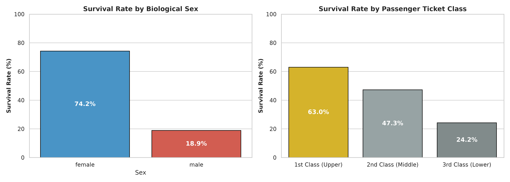
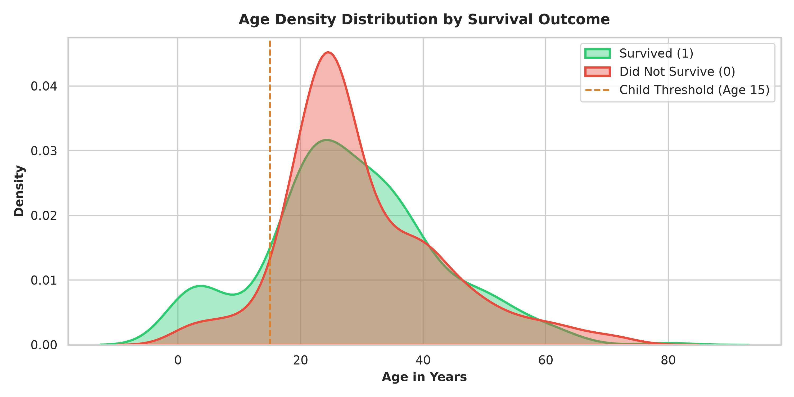
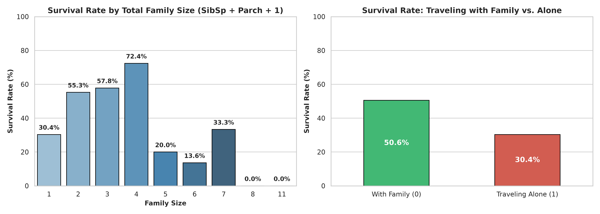
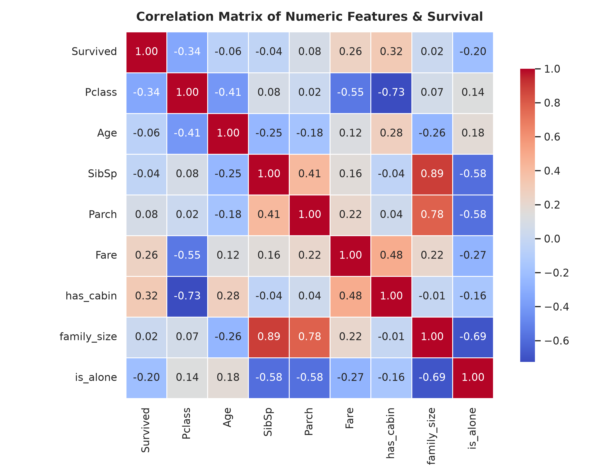
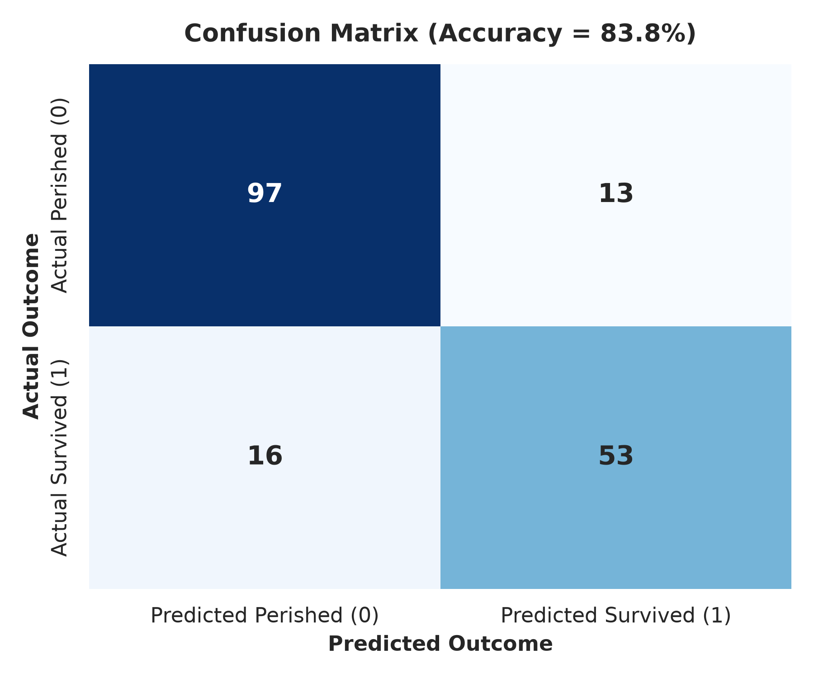
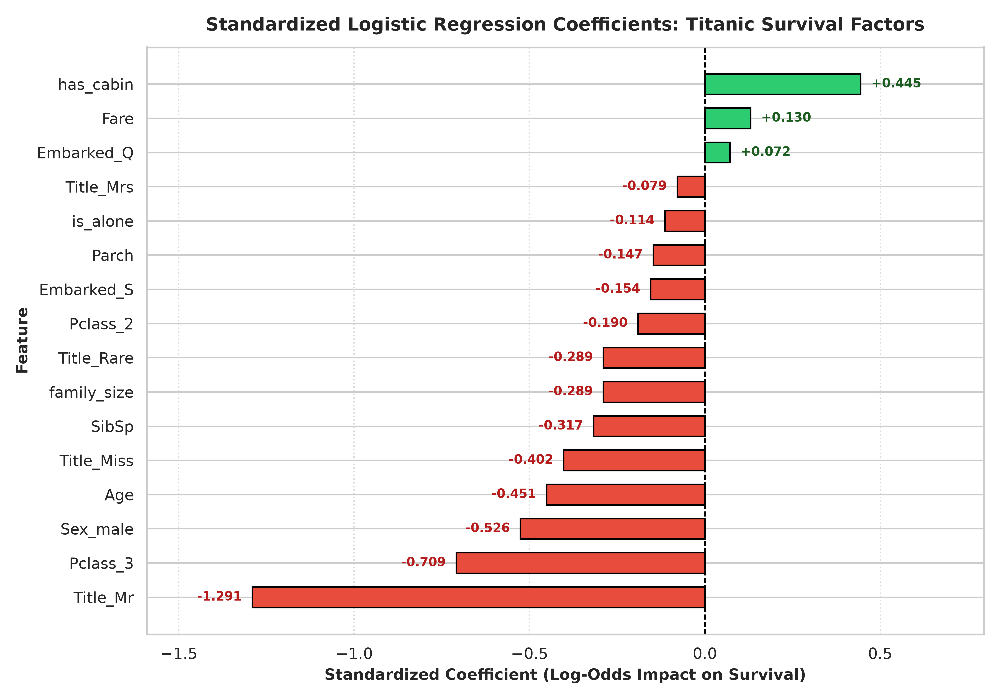

# Project 5: Titanic Survival Prediction


---

## Executive Summary
This project implements an explainable classification pipeline predicting passenger survival from the tragic 1912 maiden voyage of the RMS Titanic. Built using **Logistic Regression** and scikit-learn, the pipeline handles real-world missing data patterns, extracts predictive titles from passenger names, engineers family dynamics, and explicitly identifies the socioeconomic and demographic factors that increased or decreased a passenger's probability of survival.

- **Model Accuracy:** **83.80%**
- **Precision (Survived):** **80.30%**
- **Recall (Survived):** **76.81%**
- **F1 Score:** **78.52%**
- **ROC-AUC Score:** **0.8694**

---

## 1. Problem Statement & Business Objective

### Problem Statement
On April 15, 1912, the RMS Titanic sank after colliding with an iceberg, resulting in the death of 1,502 out of 2,224 passengers and crew. While survival involved an element of chance, historical records demonstrate that some groups of passengers were significantly more likely to survive than others due to institutional maritime rules, socioeconomic status, and physical location on the ship.

### Business Objective
1. **Explainable Classification:** Build a transparent, interpretable classification model predicting survival (`Survived`: `1` / `0`) based on demographic and voyage attributes.
2. **Quantify Decisive Survival Drivers:** Dissect and communicate the exact mathematical features that heightened or reduced survival odds, validating them against established historical accounts (e.g., the "women and children first" protocol and steerage barriers).
3. **Master End-to-End ML Best Practices:** Showcase professional data cleaning (grouped median imputation), feature engineering (title extraction, family size synthesis), and metric evaluation on imbalanced data.

---

## 2. Project Workflow Diagram

```
Data Collection ───> Data Cleaning ───> Exploratory Data Analysis (EDA)
                            │
                            ▼
GitHub Documentation <─── Model Evaluation <─── Model Building <─── Feature Engineering
```

---

## 3. Dataset Description & Preprocessing

The model is trained on the Kaggle **Titanic: Machine Learning from Disaster** dataset (`train.csv`), consisting of **891 passenger records** and **12 columns**.

### Dataset Dictionary
| Feature | Type | Description |
| :--- | :--- | :--- |
| `PassengerId` | Identifier | Unique integer sequence (Dropped prior to modeling) |
| `Survived` | Target | Survival status (**0** = Perished, **1** = Survived) |
| `Pclass` | Ordinal | Ticket class (**1** = 1st Class, **2** = 2nd Class, **3** = 3rd Class) |
| `Name` | Text | Full passenger name including formal salutations |
| `Sex` | Categorical | Biological sex (`male` / `female`) |
| `Age` | Numeric | Age in years (177 missing entries) |
| `SibSp` | Numeric | Number of siblings and/or spouses aboard |
| `Parch` | Numeric | Number of parents and/or children aboard |
| `Ticket` | Categorical | Ticket serial number (Dropped non-predictive hash) |
| `Fare` | Numeric | Passenger ticket fare (£) |
| `Cabin` | Categorical | Cabin room assignment (687 missing entries, ~77%) |
| `Embarked` | Categorical | Port of embarkation (`C` = Cherbourg, `Q` = Queenstown, `S` = Southampton) |

### Missing Data Imputation & Cleaning
1. **Grouped Median Imputation for Age (177 missing):**  
   Rather than substituting a crude global median (~28 years) which distorts demographic profiles, missing ages were imputed using the **median age calculated conditionally within each `Pclass` and `Sex` group**:
   - 1st Class Female: 35.0 years | 1st Class Male: 40.0 years
   - 2nd Class Female: 28.0 years | 2nd Class Male: 30.0 years
   - 3rd Class Female: 21.5 years | 3rd Class Male: 25.0 years
2. **Cabin Indicator Transformation (`has_cabin`):**  
   With 77.1% missing values, raw cabin numbers cannot be used directly. However, having an assigned stateroom was strongly associated with upper-deck ticket holders. A binary flag `has_cabin` (`1` if recorded, `0` if null) was engineered.
3. **Mode Imputation for Embarked (2 missing):**  
   Imputed with Southampton (`'S'`), representing over 72% of all boarding passengers.
4. **Non-Predictive Column Drops:**  
   Dropped `PassengerId`, `Name` (after title extraction), `Ticket`, and raw `Cabin`.

---

## 4. Exploratory Data Analysis (EDA)

### 4.1 Survival Rate by Biological Sex & Ticket Class


- **Biological Sex:** Female passengers survived at an overwhelming rate of **74.2%**, compared to only **18.9%** for male passengers.
- **Ticket Class:** Upper-class passengers experienced dramatic privileges:
  - **1st Class:** **63.0%** survived.
  - **2nd Class:** **47.3%** survived.
  - **3rd Class:** Only **24.2%** survived (over 75% perished).

---

### 4.2 Age Density Distribution by Survival Outcome


- **Children (< 15 years):** Prominent survival bump among infants and young children, showing that officers prioritized youngsters during boarding.
- **Young Working-Age Adults (18–35 years):** Represents the highest density of casualties, composed heavily of male 3rd class laborers and lower-deck personnel.
- **Elderly Passengers (60+ years):** Very low survival rates due to severe mobility challenges in freezing waters and rushing stairways.

---

### 4.3 Survival Rate by Family Size & Solo Travel Status


- **Small Family Units (2 to 4 members):** Maximized survival rates between **55% and 72%**. Small groups supported each other in finding lifeboats without causing mobilization delays.
- **Large Families (5+ members):** Survival rates plummeted to below **15–20%**. Evacuating large family groups under panic conditions led to fatal delays.
- **Solo Travelers (`is_alone` = 1):** Survived at only **30.4%**, significantly worse than small family units.

---

### 4.4 Numeric Correlation Matrix


- `has_cabin` (+0.32) and `Fare` (+0.26) show positive correlations with survival.
- `Pclass` (-0.34) shows a negative correlation, indicating lower survival probability as ticket class numbers increase (1st $\rightarrow$ 3rd).

---

## 5. Feature Engineering

Domain-specific features were synthesized to boost model discriminability:

1. **Title Extraction from Passenger Names:**
   Extracted honorifics using regex `r' ([A-Za-z]+)\.'`:
   - `Mr` (517) - Adult males
   - `Miss` (185) - Unmarried females & young girls
   - `Mrs` (126) - Married adult females
   - `Master` (40) - Male children (crucial to distinguish young boys from adult men)
   - `Rare` (23) - Consolidating nobility, military, and clergy (`Dr`, `Rev`, `Col`, `Major`, `Countess`, `Jonkheer`, etc.)
2. **Total Family Size (`family_size`):**
   $$\text{family\_size} = \text{SibSp} + \text{Parch} + 1$$
3. **Solo Traveler Indicator (`is_alone`):**
   $$\text{is\_alone} = \begin{cases} 1 & \text{if } \text{family\_size} = 1 \\ 0 & \text{otherwise} \end{cases}$$
4. **Stateroom Assigned Flag (`has_cabin`):**
   $$\text{has\_cabin} = \begin{cases} 1 & \text{if Cabin is not null} \\ 0 & \text{otherwise} \end{cases}$$
5. **One-Hot Encoding:** Encoded `Sex`, `Embarked`, `Title`, and `Pclass` with `drop_first=True` to preserve linear independence.

---

## 6. Model Building & Training

### Train-Test Split
- **Split Ratio:** 80% Training (712 passengers), 20% Testing (179 passengers).
- **Stratification:** Stratified by `Survived` to preserve identical class balances (38.4% survived) in train and test splits.
- **Random Seed:** 42 for reproducible benchmarking.

### Standardization
Standardized all features with `StandardScaler` ($z = \frac{x - \mu}{\sigma}$) so binary dummy indicators and continuous variables (`Age`, `Fare`, `family_size`) are on equivalent scales.

### Model Architecture
- **Classifier:** `LogisticRegression(solver='lbfgs', max_iter=1000, random_state=42)`
- **Regularization:** L2 penalty to prevent coefficient explosion.

---

## 7. Model Evaluation & Performance Results

Evaluated on 179 test passengers:

| Metric | Score | Percentage | Business / Technical Interpretation |
| :--- | :---: | :---: | :--- |
| **Accuracy** | **0.8380** | **83.80%** | Correctly predicted survival status for 150 out of 179 passengers. |
| **Precision** | **0.8030** | **80.30%** | 80% of passengers predicted to survive actually survived. |
| **Recall** | **0.7681** | **76.81%** | Identified 53 out of 69 true survivors in the test holdout. |
| **F1 Score** | **0.7852** | **78.52%** | Balanced harmonic score accounting for class distribution. |
| **ROC-AUC** | **0.8694** | **86.94%** | Excellent classification separation threshold capability. |

### Confusion Matrix


```
                       Predicted Perished (0)    Predicted Survived (1)
Actual Perished (0)             97 (TN)                   13 (FP)
Actual Survived (1)             16 (FN)                   53 (TP)
```
- **True Negatives (97):** Correctly classified casualties.
- **True Positives (53):** Correctly identified survivors.
- **False Positives (13):** Predicted to survive but perished.
- **False Negatives (16):** Survived despite difficult initial odds.

---

## 8. ADDITIONAL REQUIREMENT: Key Factors Increasing or Decreasing Survival

Standardized Logistic Regression coefficients directly reflect the change in log-odds of survival per one standard deviation increase in that predictor.  
The **Odds Ratio ($e^\beta$)** provides the multiplicative change in survival odds:



### Comprehensive Coefficients & Odds Ratios Table
| Feature | Coefficient ($\beta$) | Odds Ratio ($e^\beta$) | Factor Type | Survival Impact |
| :--- | :---: | :---: | :---: | :--- |
| **`has_cabin`** | **+0.4446** | **1.560** | **Strong Positive Factor** | **+56.0% higher odds of survival** for passengers with assigned upper-deck staterooms. |
| **`Fare`** | **+0.1305** | **1.139** | Positive Factor | +13.9% higher survival odds per standard deviation of ticket price. |
| **`Embarked_Q`** | **+0.0719** | **1.075** | Neutral / Mild | Marginal positive effect for Queenstown embarkation. |
| **`Title_Mrs`** | **-0.0787** | **0.924** | Moderate | Reference group (`Master` child) benchmark. |
| **`is_alone`** | **-0.1137** | **0.893** | Negative Factor | Solo passengers suffered an -10.7% decrease in survival odds. |
| **`Parch`** | **-0.1472** | **0.863** | Negative Factor | Higher parent-child count introduced evacuation drag. |
| **`Embarked_S`** | **-0.1544** | **0.857** | Negative Factor | -14.3% lower survival odds for Southampton passengers. |
| **`Pclass_2`** | **-0.1903** | **0.827** | Negative Factor | -17.3% lower odds compared to First Class. |
| **`family_size`**| **-0.2894** | **0.749** | Negative Factor | Large families faced severe lifeboat boarding bottlenecks. |
| **`Title_Rare`** | **-0.2891** | **0.749** | Negative Factor | Officers and clergy who remained behind to maintain order. |
| **`SibSp`** | **-0.3172** | **0.728** | Negative Factor | Sibling coordination constraints lowered survival odds. |
| **`Title_Miss`** | **-0.4024** | **0.669** | Demographic Factor | Relative to young male children (`Master` baseline). |
| **`Age`** | **-0.4514** | **0.637** | **Strong Negative Factor** | Older age reduced survival odds by **-36.3%** per SD unit. |
| **`Sex_male`** | **-0.5259** | **0.591** | **Strong Negative Factor** | Biological males faced **-40.9% lower odds** of survival. |
| **`Pclass_3`** | **-0.7089** | **0.492** | **Major Rejection Factor** | 3rd Class passengers were **50.8% less likely to survive** than 1st Class. |
| **`Title_Mr`** | **-1.2907** | **0.275** | **Decisive Negative Factor** | Adult male title reduced survival odds by **-72.5%** (Odds Ratio = 0.28). |

---

### In-Depth Historical Synthesis: Why Passengers Survived or Perished

#### 1. Factors That Increased Chance of Survival:
- **Upper-Deck Stateroom Proximity (`has_cabin`, $\beta = +0.445$):** Passengers occupying private staterooms on decks A, B, and C had immediate physical access to boat davits, increasing survival odds by **56%**.
- **Financial Affluence (`Fare`, $\beta = +0.130$):** First-class passengers enjoyed personalized steward alerts, escorting them to the boat deck early during the sinking.
- **Children (`Title_Master`):** Young boys (holding the title `Master`) were loaded into lifeboats alongside female passengers, achieving a **57.5% survival rate**, compared to less than 16% for adult men.

#### 2. Factors That Decreased Chance of Survival:
- **Adult Male Status (`Title_Mr`, $\beta = -1.291$ / `Sex_male`, $\beta = -0.526$):** The maritime protocol *"Women and children first"* was rigorously enforced by First Officer Murdoch on the starboard side and Second Officer Lightoller on the port side. Lightoller went as far as allowing lifeboats to drop with empty seats rather than letting able-bodied adult men board.
- **Third-Class Steerage Ticket (`Pclass_3`, $\beta = -0.709$):** Steerage quarters were located in the deepest bow and stern compartments. Passengers faced locked physical barrier gates, convoluted stairwells, and non-English signage, causing them to reach the boat deck only after the majority of lifeboats had already departed.
- **Older Age (`Age`, $\beta = -0.451$):** Older passengers had lower physical resilience in sub-zero waters and were not prioritized by lifeboat crews.
- **Large Family Disorganization (`family_size`, $\beta = -0.289$):** Sizable immigrant families (such as the Sage family of 11) suffered complete loss of life as parents refused to board lifeboats without locating all of their children across segregated decks.

---

## 9. Common Mistakes Avoided

1. **No Data Loss via Naive Deletions:** Rather than dropping 177 rows with missing `Age`, conditional median imputation grouped by `Pclass` and `Sex` preserved all records.
2. **Stratified Partitioning:** Stratified splitting prevented class distribution distortion between the 61.6% perished and 38.4% survived populations.
3. **Multi-Metric Evaluation:** Looked beyond raw accuracy to inspect precision, recall, and F1 scores on both positive and negative classes.
4. **Feature Engineering on Unstructured Text:** Leveraged regex title extraction from names to unmask hidden child indicators (`Master`) and adult male indicators (`Mr`).

---

## 10. Repository & File Structure

```
AIML-Project-Titanic-Survival-Prediction/
├── Dataset/
│   ├── titanic.csv                    # Original dataset (891 rows, 12 columns)
│   └── titanic_cleaned.csv            # Cleaned, imputed dataset with engineered features
├── Notebook/
│   └── titanic_survival_prediction.ipynb # Fully executed 28-cell Jupyter Notebook
├── Images/
│   ├── 01_survival_by_sex_and_pclass.png
│   ├── 02_age_distribution_by_survival.png
│   ├── 03_survival_by_family_size.png
│   ├── 04_correlation_heatmap.png
│   ├── 05_confusion_matrix.png
│   └── 06_survival_factors_coefficients.png
└── README.md                          # Comprehensive documentation & historical analysis
```

---

## 11. Setup & Installation Instructions

```bash
# 1. Clone repository
git clone https://github.com/<your-username>/AIML-Project-Titanic-Survival-Prediction.git
cd AIML-Project-Titanic-Survival-Prediction

# 2. Install required dependencies
pip install pandas numpy matplotlib seaborn scikit-learn

# 3. Launch the Jupyter Notebook
jupyter notebook Notebook/titanic_survival_prediction.ipynb
```

---

## 12. Submission Checklist Verification

- [x] Dataset downloaded and loaded successfully into notebook.
- [x] All Data Cleaning Tasks completed (grouped median Age, mode Embarked, has_cabin flag, identifier drops).
- [x] At least 4 EDA visualizations created and thoroughly explained.
- [x] Feature engineering applied (`Title`, `family_size`, `is_alone`, `has_cabin`, One-Hot encoded).
- [x] Logistic Regression model trained with standardized features.
- [x] Evaluation metrics calculated, printed, and interpreted (Accuracy: 83.80%, Recall: 76.81%, Precision: 80.30%, F1: 78.52%).
- [x] Additional requirement completed: Explained factors increasing and decreasing survival chances connected to Titanic history.
- [x] Formatted Jupyter Notebook generated with executed outputs.
- [x] Standard folder structure implemented and comprehensive `README.md` created.
# AI-ML--Project-RollNo-2024355
TITANIC SURVIVAL PRIDICTION USING MACHINE LEARNING
